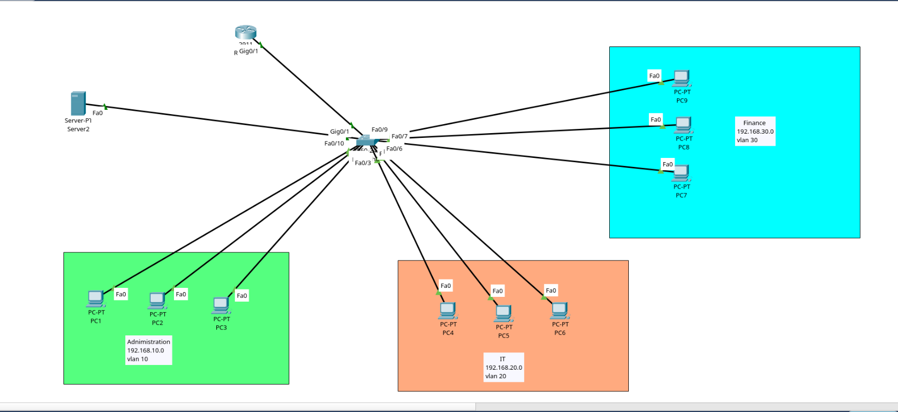
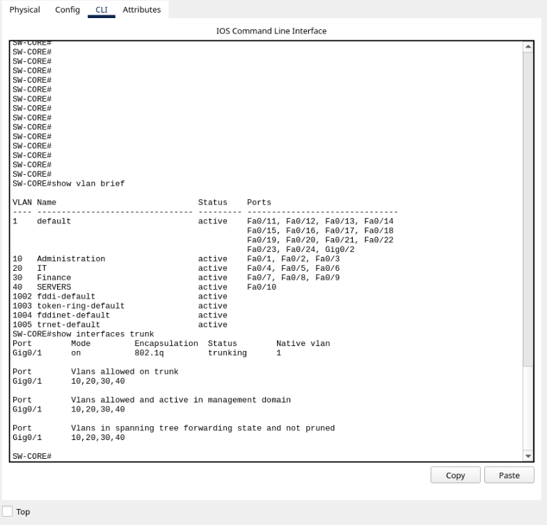
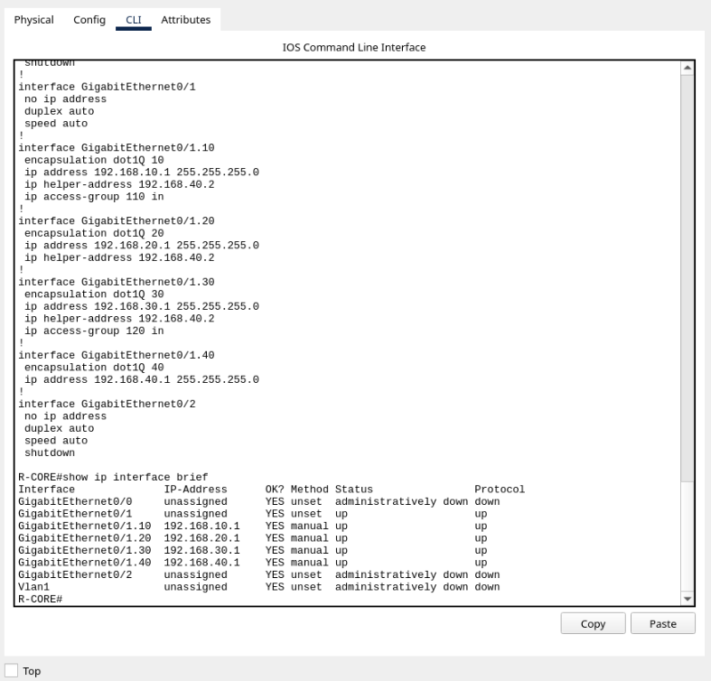
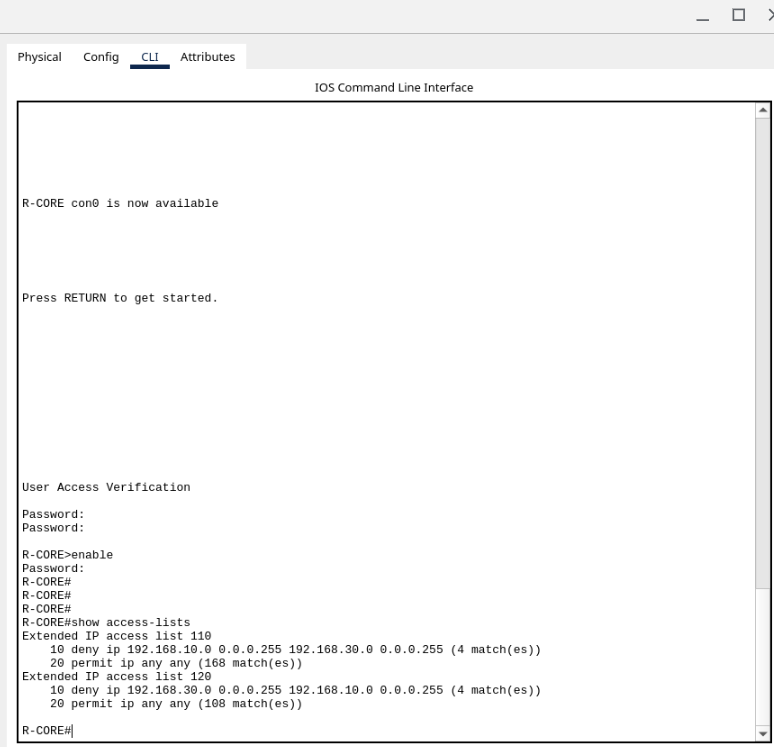
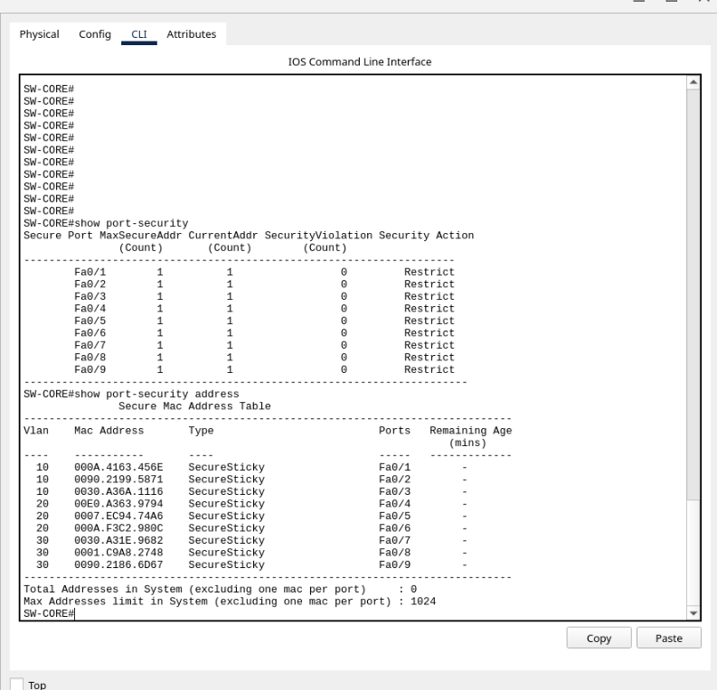
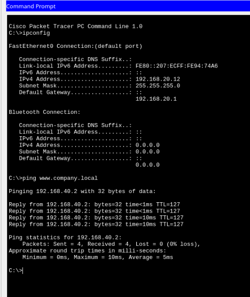

# Cisco Enterprise Network: VLAN Segmentation and Network Security

A segmented and secured enterprise network designed and tested in **Cisco Packet Tracer**. It covers VLANs, Router-on-a-Stick inter-VLAN routing, centralized DHCP and DNS, access control lists, Port Security and SSH remote management.

> **Note:** this is a simulated lab built in Cisco Packet Tracer. It is not a production deployment.

## Objectives

- Separate four departments into their own VLANs and subnets
- Route between VLANs with a single router interface (Router-on-a-Stick)
- Serve DHCP and DNS from one central server using DHCP relay
- Restrict traffic between Administration and Finance with extended ACLs
- Limit access to switch ports with Port Security
- Manage the router and the switch securely with SSH version 2

## Devices

| Device | Model | Hostname |
|---|---|---|
| Router | Cisco 2911 | R-CORE |
| Switch | Cisco 2960 | SW-CORE |
| Server | Server-PT | DHCP and DNS |
| Clients | PC-PT x 9 | PC1 to PC9 |

## Addressing plan

| VLAN | Department | Network | Gateway |
|---|---|---|---|
| 10 | Administration | 192.168.10.0/24 | 192.168.10.1 |
| 20 | IT | 192.168.20.0/24 | 192.168.20.1 |
| 30 | Finance | 192.168.30.0/24 | 192.168.30.1 |
| 40 | Servers | 192.168.40.0/24 | 192.168.40.1 |

- Server: `192.168.40.2` (DHCP and DNS)
- Switch management interface (VLAN 40): `192.168.40.3`

### Switch port allocation

| Ports | Device | VLAN |
|---|---|---|
| Fa0/1 to Fa0/3 | PC1 to PC3 | 10 |
| Fa0/4 to Fa0/6 | PC4 to PC6 | 20 |
| Fa0/7 to Fa0/9 | PC7 to PC9 | 30 |
| Fa0/10 | Server | 40 |
| Gi0/1 | Trunk to R-CORE | Trunk (VLANs 10, 20, 30, 40) |

## How it works

### Inter-VLAN routing (Router-on-a-Stick)
R-CORE uses one physical interface (`GigabitEthernet0/1`) with four 802.1Q subinterfaces, one per VLAN. Each subinterface is the default gateway of its VLAN. This avoids using a separate router port for each VLAN.

### Centralized DHCP and DNS
The server sits in VLAN 40 and provides three DHCP pools (Administration, IT, Finance), each starting at `.10` with a maximum of 50 users. Because the clients are in other VLANs, the router forwards their DHCP requests to the server with `ip helper-address 192.168.40.2` on the three client subinterfaces. The server also answers DNS queries, for example `www.company.local`.

### Access control lists

| ACL | Applied on | Effect |
|---|---|---|
| 110 | `G0/1.10` inbound | Denies Administration to Finance |
| 120 | `G0/1.30` inbound | Denies Finance to Administration |

Both end with `permit ip any any`, so all other traffic is allowed.

### Port Security
Configured on Fa0/1 to Fa0/9: access mode, maximum 1 MAC address per port, sticky MAC learning, violation mode `restrict`.

### SSH
SSH version 2 with local authentication on the router and the switch. The VTY lines are set to `transport input ssh`.

## Verification

| Test | Result | Evidence |
|---|---|---|
| VLANs on the right ports, trunk Gi0/1 carrying VLANs 10/20/30/40 | Verified | [vlan-trunk](screenshots/vlan-trunk.png) |
| Router subinterfaces up/up, helper-address and ACLs applied | Verified | [router-interfaces](screenshots/router-interfaces.png) |
| Clients receive addresses from the central DHCP server | Verified | [ipconfig /all](screenshots/dhcp-client-ipconfig-all.png) |
| Finance DHCP pool configuration | Verified | [dhcp-finance-pool](screenshots/dhcp-finance-pool.png) |
| DNS: `www.company.local` resolves to 192.168.40.2 | Verified | [dns-resolution](screenshots/dns-resolution.png) |
| Administration to Finance blocked | Verified | [ping](screenshots/ping-admin-to-finance-blocked.png) |
| Finance to Administration blocked | Verified | [ping](screenshots/ping-finance-to-admin-blocked.png) |
| ACL deny rules matched traffic (4 matches each) | Verified | [acl-verification](screenshots/acl-verification.png) |
| IT reaches Administration and Finance | Verified | [ping](screenshots/ping-it-allowed.png) |
| Administration reaches the server | Verified | [ping](screenshots/ping-admin-to-server.png) |
| 9 sticky MAC addresses learned, one per port | Verified | [port-security](screenshots/port-security.png) |
| SSH v2 enabled on the router | Verified | [ssh-verification](screenshots/ssh-verification.png) |
| SSH v2 enabled on the switch | Verified | [switch](screenshots/port-security-and-ssh-switch.png) |
| SSH login to the router from a PC | Verified | [ssh-login-router](screenshots/ssh-login-router.png) |

### Screenshots

**VLANs and trunk**

**Router subinterfaces**

**ACL verification**

**Port Security**

**DNS resolution**

## Problems and solutions

- **One DHCP server for several VLANs:** the clients are not in the server's VLAN, so their broadcast requests never reached it. Adding `ip helper-address 192.168.40.2` on the three client subinterfaces solved it.
- **DHCP pool names:** the default `serverPool` entry in Packet Tracer cannot be renamed, so three separate pools were created for the departments.
- **SSH login:** the first login attempt to the switch timed out because the password was not entered in time. A second attempt succeeded.
- **Port Security display:** an earlier `show port-security` output showed a current address count of 0 even though `show port-security address` listed the sticky MACs. After the final configuration, the summary shows 1 secure address per port.

## Limitations

- Simulated lab: no real hardware, traffic or users.
- Port Security was configured and sticky MACs were learned, but a **violation test was not performed**.
- Port Security was configured only on Fa0/1 to Fa0/9, not on the server port (Fa0/10).
- Access from Finance to the server was not tested.
- No redundancy: a single router, switch and server.

## Skills demonstrated

VLANs, 802.1Q trunking, inter-VLAN routing, DHCP and DHCP relay, DNS, extended ACLs, Port Security, SSH, network documentation and troubleshooting.
